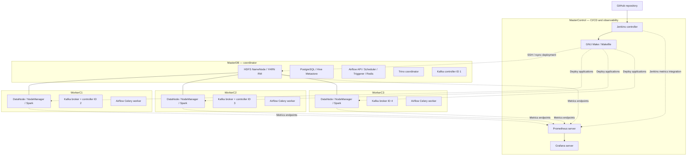
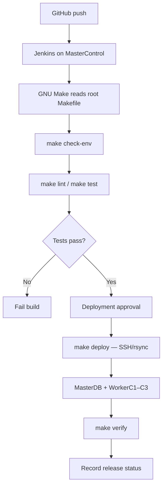
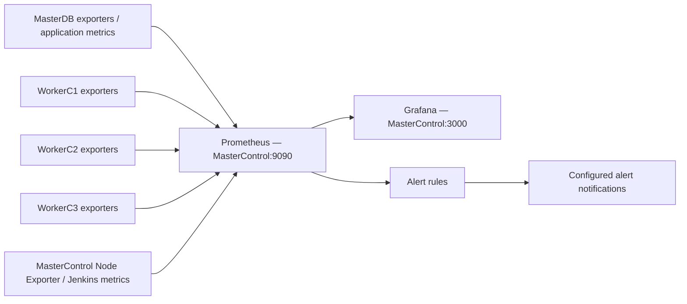

# Industrial IoT Data Engineering Pipeline for Predictive Maintenance

**Version:** 2.0.0\
**Last Updated:** 07-01-2026\
**Environment:** Five-Node Distributed Cluster\

---

## Project Overview

The Industrial IoT Data Engineering Pipeline for Predictive Maintenance is a distributed data engineering platform for simulating, ingesting, processing, storing, and analyzing industrial machine telemetry.

The project uses the [Industrial IoT Dataset (Synthetic)](https://www.kaggle.com/datasets/canozensoy/industrial-iot-dataset-synthetic?select=factory_sensor_simulator_2040.csv) from Kaggle, with `factory_sensor_simulator_2040.csv` as the selected source file.

The pipeline uses Python, Apache Kafka, Apache Spark Structured Streaming, Hadoop HDFS, and Apache Iceberg to implement a Bronze–Silver–Gold lakehouse.

Predictive-maintenance models support machine failure classification and Remaining Useful Life regression. Apache Airflow orchestrates scheduled workflows, while Trino and Apache Superset provide analytical querying and visualization.

**MasterControl serves as the centralized DevOps and observability node**, hosting Jenkins, Prometheus, Grafana, and GNU Make.

- Jenkins automates software testing and deployment.
- GNU Make standardizes development and operational commands.
- Prometheus collects metrics from the distributed cluster.
- Grafana provides infrastructure, pipeline, and CI/CD dashboards.

## Key Capabilities

- Configurable IoT telemetry simulation.
- Distributed Kafka ingestion.
- Spark Structured Streaming.
- Bronze–Silver–Gold Iceberg lakehouse.
- Data validation and quality monitoring.
- Failure prediction and RUL estimation.
- Airflow workflow orchestration.
- Trino SQL analytics and Superset dashboards.
- Jenkins CI/CD Integration.
- Makefile-based automation.
- Prometheus metrics collection on MasterControl.
- Grafana visualization on MasterControl.
- Distributed node and application monitoring.
- Scalability and fault-tolerance experiments.

## Cluster Architecture

The project uses a **five-node CentOS Stream 9 cluster** hosted on VirtualBox. MasterControl centralizes CI/CD and observability; MasterDB coordinates the distributed services; and WorkerC1–WorkerC3 execute processing, storage, messaging, and Airflow tasks. Service roles describe the intended deployment and should be validated against running services.

### Cluster Node Inventory

| Node | Role | Services |
| --- | --- | --- |
| **MasterControl** | DevOps and observability | Jenkins controller, GNU Make, Git, SSH/rsync, Prometheus server, Grafana server, Node Exporter |
| **MasterDB** | Distributed coordinator | HDFS NameNode/SecondaryNameNode, YARN ResourceManager, PostgreSQL 16, Hive Metastore, Kafka controller (ID 1), Airflow API Server/Scheduler/Triggerer, Redis, Trino coordinator, Node Exporter |
| **WorkerC1** | Distributed worker | HDFS DataNode, YARN NodeManager, Spark execution, Kafka broker/controller (ID 2), Airflow Celery worker, Node Exporter |
| **WorkerC2** | Distributed worker | HDFS DataNode, YARN NodeManager, Spark execution, Kafka broker/controller (ID 3), Airflow Celery worker, Node Exporter |
| **WorkerC3** | Distributed worker | HDFS DataNode, YARN NodeManager, Spark execution, Kafka broker (ID 4), Airflow Celery worker, Node Exporter |

### Five-Node Cluster Diagram



### Kafka KRaft Topology

Kafka operates without ZooKeeper. The three-controller quorum is separate from the three-broker ingestion layer.

| Node | Kafka node ID | Controller | Broker |
| --- | ---: | :---: | :---: |
| MasterDB | 1 | Yes | No |
| WorkerC1 | 2 | Yes | Yes |
| WorkerC2 | 3 | Yes | Yes |
| WorkerC3 | 4 | No | Yes |

**Controller quorum:** `1@MasterDB:9093,2@WorkerC1:9093,3@WorkerC2:9093`  
**Broker bootstrap endpoints:** `WorkerC1:9092,WorkerC2:9092,WorkerC3:9092`

### HDFS, YARN, and Spark

- **HDFS:** MasterDB hosts the NameNode; WorkerC1–WorkerC3 host DataNodes. The planned HDFS replication factor is **2**.
- **YARN:** MasterDB hosts the ResourceManager; worker nodes host NodeManagers.
- **Spark:** Structured Streaming, Bronze/Silver/Gold processing, and MLlib jobs use resources allocated by YARN. Executor placement depends on available resources and scheduler decisions.
- **Iceberg:** Tables reside on HDFS, with Hive Metastore backed by PostgreSQL for catalog metadata.

### Distributed Apache Airflow

Airflow 3.0.2 uses **CeleryExecutor** in the proposed topology. MasterDB hosts the API Server, Scheduler, Triggerer, metadata database, and Redis broker; WorkerC1, WorkerC2, and WorkerC3 host Celery workers. Airflow orchestrates scheduled validation, feature engineering, training, evaluation, and retraining; Kafka and Spark remain responsible for continuous telemetry processing.

### CI/CD Architecture — MasterControl



**Jenkins** schedules and controls CI/CD; **GNU Make** interprets the project's `Makefile`; **shell scripts** implement deployment actions. Docker, Ansible, Terraform, and Kubernetes are not required for the initial design.

### Centralized Monitoring Architecture — MasterControl



Prometheus **scrapes** exporters and instrumented endpoints across the cluster; Grafana queries Prometheus for dashboards. Node Exporter is planned on all five nodes (typically port `9100`). Kafka, Spark, HDFS/YARN, Airflow, and Jenkins require appropriate metrics endpoints or integrations beyond Node Exporter. Alert notifications require configured routing, such as Alertmanager or Grafana Alerting.

**Management endpoints (defaults, subject to configuration):**

| Service | Address |
| --- | --- |
| Jenkins | `http://MasterControl:8080` |
| Prometheus | `http://MasterControl:9090` |
| Grafana | `http://MasterControl:3000` |

Restrict management endpoints to trusted networks or protect them with authenticated HTTPS access.

---

## Data Flow

The processing workflow remains:

```
Kaggle Industrial IoT Dataset
           |
           v
Python IoT Simulator
           |
           v
Apache Kafka
           |
           v
Spark Structured Streaming
           |
           v
Iceberg Bronze
           |
           v
Iceberg Silver
           |
           v
Iceberg Gold
           |
      +----+----+
      |         |
      v         v
Machine ML    Trino
Models          |
      |         v
      |       Superset
      v
Prediction Results
```

Jenkins manages deployment of application changes, while Prometheus and Grafana observe the deployed services.

## Dataset Inventory

**Source:** [Industrial IoT Dataset (Synthetic) — Kaggle](https://www.kaggle.com/datasets/canozensoy/industrial-iot-dataset-synthetic?select=factory_sensor_simulator_2040.csv)

**Selected file:** `factory_sensor_simulator_2040.csv`

The project uses machine identifiers, machine types, operating hours, temperature, vibration, oil and coolant levels, power consumption, maintenance history, failure history, and other industrial sensor measurements.

The proposed predictive-maintenance targets are:

- `Failure_Within_7_Days`
- `Remaining_Useful_Life_days`

The actual CSV schema must be verified before implementation.

## Data Warehouse Model

Apache Iceberg tables on HDFS provide the analytical lakehouse.

| Layer  | Purpose                                                 |
| ------ | ------------------------------------------------------- |
| Bronze | Raw machine telemetry                                   |
| Silver | Validated and standardized telemetry                    |
| Gold   | Predictive-maintenance features and analytical datasets |

The Gold layer may expose machine, date, maintenance, telemetry, failure, and prediction fact/dimension tables for Trino and Superset.

## Data Quality Framework

Data-quality validation includes completeness, accuracy, validity, consistency, uniqueness, timeliness, and referential integrity.

Examples include checking non-null machine identifiers, valid sensor ranges, duplicate events, timestamp validity, and acceptable missing-value rates.

Airflow schedules data-quality jobs, Spark executes distributed validations, and Prometheus can expose quality metrics for Grafana alerting.

## Technology Stack

| Technology      | Role                   | Primary Node                |
| --------------- | ---------------------- | --------------------------- |
| Jenkins         | CI/CD                  | MasterControl               |
| GNU Make        | Automation             | MasterControl               |
| Prometheus      | Metrics collection     | MasterControl               |
| Grafana         | Monitoring dashboards  | MasterControl               |
| Node Exporter   | Host metrics           | All nodes                   |
| Kafka           | Event ingestion        | MasterDB, WorkerC1–C3       |
| Spark           | Distributed processing | YARN cluster                |
| Hadoop HDFS     | Distributed storage    | MasterDB, workers           |
| Apache Iceberg  | Lakehouse tables       | HDFS/Spark                  |
| PostgreSQL      | Metadata storage       | MasterDB                    |
| Hive Metastore  | Catalog metadata       | MasterDB                    |
| Apache Airflow  | Workflow orchestration | MasterDB, workers           |
| Trino           | Distributed SQL        | MasterDB                    |
| Apache Superset | Analytics dashboards   | Configured application host |
| Spark MLlib     | Predictive maintenance | Spark cluster               |
| Git/GitHub      | Source control         | Remote repository           |

## Directory Structure

```
scalable-industrial-iot-pipeline/
├── README.md
├── LICENSE
├── .env.example
├── requirements.txt
├── requirements-dev.txt
├── Makefile
├── Jenkinsfile
├── data/
│   ├── raw/
│   ├── sample/
│   └── schema/
├── simulator/
│   ├── iot_simulator.py
│   └── kafka_producer.py
├── kafka/
│   ├── topics/
│   ├── config/
│   └── scripts/
├── spark/
│   ├── streaming/
│   ├── bronze/
│   ├── silver/
│   └── gold/
├── iceberg/
│   ├── ddl/
│   └── maintenance/
├── ml/
│   ├── failure_prediction/
│   ├── rul_prediction/
│   └── inference/
├── airflow/
│   └── dags/
├── jenkins/
│   ├── README.md
│   └── scripts/
├── monitoring/
│   ├── prometheus/
│   │   ├── prometheus.yml
│   │   ├── rules/
│   │   └── exporters/
│   ├── grafana/
│   │   ├── dashboards/
│   │   └── provisioning/
│   └── alerting/
├── scripts/
│   ├── init.sh
│   ├── check-env.sh
│   ├── deploy.sh
│   ├── deploy-spark.sh
│   ├── deploy-airflow.sh
│   ├── deploy-ml.sh
│   ├── verify-deployment.sh
│   └── rollback.sh
├── trino/
│   ├── catalog/
│   └── queries/
├── superset/
│   └── dashboards/
├── tests/
│   ├── unit/
│   ├── integration/
│   └── data_quality/
├── experiments/
│   ├── scalability/
│   ├── fault_tolerance/
│   ├── ml_evaluation/
│   └── cicd_performance/
└── docs/
    ├── architecture/
    ├── experiments/
    ├── results/
    └── cicd/
```

## Directory Description

| Directory                | Description                                 |
| ------------------------ | ------------------------------------------- |
| `data/`                  | Source data and schemas                     |
| `simulator/`             | IoT event generation                        |
| `kafka/`                 | Event streaming configuration               |
| `spark/`                 | Distributed processing jobs                 |
| `iceberg/`               | Lakehouse DDL and maintenance               |
| `ml/`                    | Predictive-maintenance models               |
| `airflow/`               | Scheduled workflow definitions              |
| `jenkins/`               | CI/CD configuration and utilities           |
| `monitoring/prometheus/` | Scrape configurations, exporters, and rules |
| `monitoring/grafana/`    | Dashboard and data-source definitions       |
| `monitoring/alerting/`   | Alert routing configuration                 |
| `scripts/`               | Deployment and operations                   |
| `tests/`                 | Automated validation                        |
| `experiments/`           | Performance evaluation                      |
| `docs/`                  | Project documentation                       |

## Quick Start

### Prerequisites

- Five configured virtual machines.
- Working Hadoop, Kafka, Spark, and Airflow services.
- Jenkins, Prometheus, and Grafana installed on MasterControl.
- Metrics exporters on monitored nodes.
- Git, Python, GNU Make, and SSH access.

### Initialize the Project

```
git clone <repository-url>
cd scalable-industrial-iot-pipeline

cp .env.example .env
make init
make check-env
```

### Validate and Deploy

```
make lint
make test
make deploy
make verify
```

These targets must be implemented before use.

### Access Management Services

The following are proposed default endpoints, assuming standard service ports and suitable network access.

| Service    | URL                         |
| ---------- | --------------------------- |
| Jenkins    | `http://MasterControl:8080` |
| Prometheus | `http://MasterControl:9090` |
| Grafana    | `http://MasterControl:3000` |

These endpoints must be confirmed against the actual installation and should be restricted to trusted networks or protected behind authenticated HTTPS access.

## Makefile Commands

| Command          | Description                |
| ---------------- | -------------------------- |
| `make help`      | Display available commands |
| `make init`      | Initialize environment     |
| `make check-env` | Validate configuration     |
| `make lint`      | Check Python code          |
| `make test`      | Run tests                  |
| `make deploy`    | Deploy application code    |
| `make verify`    | Verify deployment          |
| `make rollback`  | Restore previous release   |
| `make clean`     | Clean temporary files      |

Additional targets may be introduced for monitoring configuration validation and controlled service management.

## Monitoring & Alerting

### Prometheus Server

**Host:** MasterControl\
**Default Port:** 9090

Prometheus collects metrics from exporters and instrumented services across the cluster.

Example `monitoring/prometheus/prometheus.yml`:

```
global:
  scrape_interval: 15s
  evaluation_interval: 15s

scrape_configs:
  - job_name: "node-exporter"
    static_configs:
      - targets:
          - "MasterControl:9100"
          - "MasterDB:9100"
          - "WorkerC1:9100"
          - "WorkerC2:9100"
          - "WorkerC3:9100"

  - job_name: "prometheus"
    static_configs:
      - targets:
          - "MasterControl:9090"
```

The Node Exporter targets assume exporters are installed, enabled, and reachable on port 9100.

Kafka, Spark, HDFS, YARN, Airflow, and Jenkins metrics require their corresponding exporters or metrics integrations to be configured separately.

### Grafana Server

**Host:** MasterControl\
**Default Port:** 3000

Grafana connects to Prometheus using:

`http://localhost:9090`

Suggested dashboards:

| Dashboard              | Metrics                                        |
| ---------------------- | ---------------------------------------------- |
| Cluster Overview       | Node availability, CPU, memory, disk           |
| Kafka Monitoring       | Broker health, throughput, consumer lag        |
| Spark Performance      | Processing rate, latency, executor utilization |
| HDFS/YARN              | Storage, DataNodes, cluster resources          |
| Airflow Monitoring     | DAG failures, task duration, worker health     |
| Jenkins CI/CD          | Build failures, durations, deployments         |
| Predictive Maintenance | Prediction throughput and model health         |

### Alerting

Proposed alerts include:

- Node unavailable.
- High CPU or memory utilization.
- Disk capacity approaching threshold.
- Kafka broker failure.
- Excessive Kafka consumer lag.
- Spark streaming job failure.
- Airflow DAG failure.
- Jenkins deployment failure.
- Data-quality threshold breach.

Prometheus evaluates alert rules. Alert notifications require a configured notification route, such as Grafana Alerting or Alertmanager.

## Troubleshooting

| Issue                      | Recommended Action                              |
| -------------------------- | ----------------------------------------------- |
| Jenkins unavailable        | Check Jenkins service and port                  |
| Prometheus unavailable     | Check Prometheus service and configuration      |
| Grafana unavailable        | Check Grafana service and port                  |
| Prometheus target DOWN     | Verify exporter process, firewall, and hostname |
| Missing Grafana metrics    | Check Prometheus data source and queries        |
| Jenkins deployment failure | Inspect Jenkins logs and SSH credentials        |
| Missing Kafka metrics      | Verify Kafka exporter/JMX configuration         |
| Missing Spark metrics      | Verify Spark metrics exposure                   |
| Airflow task failure       | Review Airflow task logs                        |

Useful commands on MasterControl, assuming systemd-managed installations:

```
sudo systemctl status jenkins
sudo systemctl status prometheus
sudo systemctl status grafana-server
sudo systemctl status node_exporter
```

Validate Prometheus configuration when `promtool` is installed:

```
promtool check config \
  monitoring/prometheus/prometheus.yml
```

## Support

Report project issues through the GitHub repository's Issues section once published.

Include the affected component, relevant logs, reproduction steps, and software versions. Remove credentials and sensitive information before sharing logs.

## License

This project is intended for **educational and internal use only**.

Third-party dependencies and datasets remain subject to their respective terms.

## Contributors

Contributions may cover distributed data engineering, IoT simulation, machine learning, CI/CD automation, monitoring, experimental evaluation, and documentation.

Contributor names will be added when confirmed.

## Version

**Current Version:** 2.0.0\
**Last Updated:** 07-01-2026

Version 2.0.0 includes the proposed five-node architecture, Jenkins CI/CD, GNU Make automation, and centralized Prometheus/Grafana monitoring on MasterControl.

**Project Status:** Architecture and implementation plan. Component installation and operational readiness must be verified independently.
