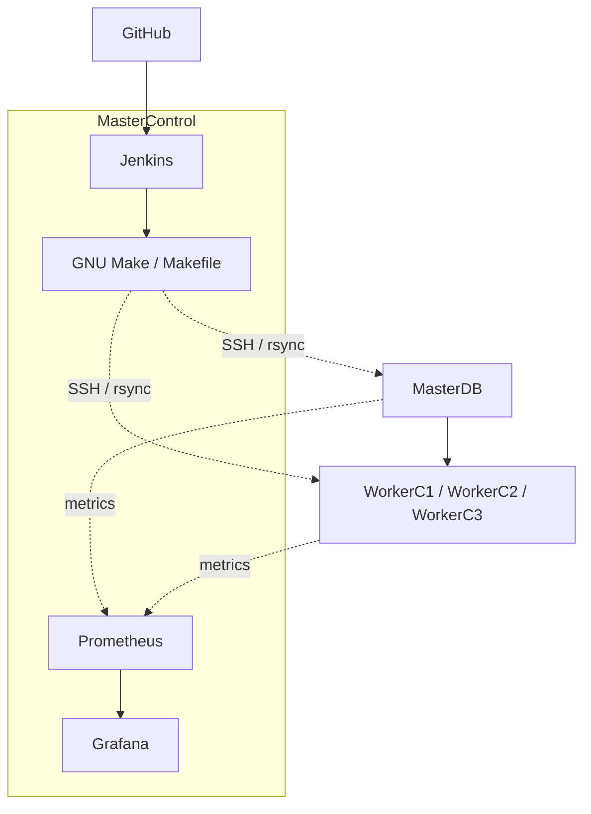

# Cluster architecture

- MasterControl: Jenkins controller, GNU Make, Prometheus, Grafana.
- MasterDB: HDFS NameNode, YARN ResourceManager, PostgreSQL, Hive Metastore, Airflow scheduler/API/triggerer, Trino coordinator, Kafka KRaft controller (1).
- WorkerC1/C2: HDFS DataNode, YARN NodeManager, Spark execution, Kafka broker/controller (2/3), Airflow Celery workers.
- WorkerC3: HDFS DataNode, YARN NodeManager, Spark execution, Kafka broker (4), Airflow Celery worker.
- Kafka broker endpoints: WorkerC1:9092, WorkerC2:9092, WorkerC3:9092.
- Kafka controller quorum: MasterDB:9093, WorkerC1:9093, WorkerC2:9093.
- HDFS replication: 2.

